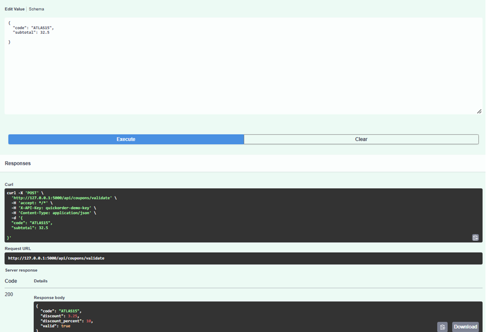

# BUG-01 : Le coupon ATLAS15 n'applique pas la réduction annoncée

## Contexte
Lors de la comparaison entre le texte promotionnel affiché sur la fiche restaurant et la réponse de
l'API de validation du coupon, un écart a été constaté. Le restaurant "Couscous Atlas" affiche une promotion
"🎟️ Code ATLAS15 annoncé comme -15% sur ce restaurant", et la fiche restaurant précise même "utilisez le
code ATLAS15 pour obtenir 15 % de réduction". Sauf que le coupon réellement enregistré en base applique
10 %, pas 15.

## Préconditions
- Aucune authentification requise (endpoint public avec clé API).
- Restaurant "Couscous Atlas" (id=5), minimum de commande 25 €.

## Étapes de reproduction
1. Appeler `POST /api/coupons/validate` avec `{"code":"ATLAS15","subtotal":25}` (clé `X-API-Key: quickorder-demo-key`).
2. Comparer la réduction retournée à la promotion annoncée sur la fiche restaurant (-15 %).

## Résultat attendu
Réduction de 15 % sur 25 € = 3,75 €.

## Résultat obtenu
```json
{
  "code": "ATLAS15",
  "discount": 2.5,
  "discount_percent": 10.0,
  "valid": true
}
```
Réduction réelle : 10 % (2,50 €), soit 1,25 € de moins que ce qui est annoncé au client.

## Preuve
Requête/réponse ci-dessus, exécutée le 21/09/2026 contre l'instance locale `http://127.0.0.1:5000`.
Texte de la promotion vu sur `/restaurant/5` : « utilisez le code ATLAS15 pour obtenir 15 % de réduction ».

Même constat dans Swagger (22/09/2026, Marina), avec un sous-total de 32,50 € : `discount_percent: 10`,
`discount: 3.25` au lieu de 4,88 € :


## Sévérité
Moyenne. La plateforme applique une réduction inférieure à celle annoncée, ce qui peut entraîner une
réclamation client.

## Priorité
Haute, car le correctif est limité : il faut aligner `discount_percent` sur 15 en base ou corriger le
texte promotionnel pour qu'il corresponde à la réduction réelle.
