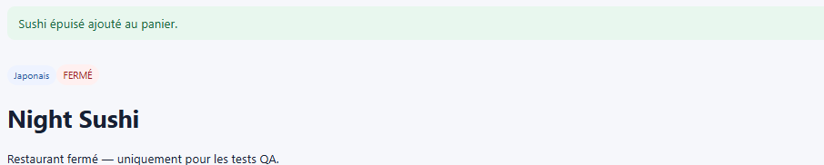

# BUG-06 : Il est possible de commander auprès d'un restaurant fermé

## Contexte
Le restaurant "Night Sushi" (id=6) est renvoyé par l'API avec `is_open: false` ("Fermé aujourd'hui").
Une commande ne devrait pas pouvoir être passée lorsqu'un restaurant est fermé.

## Préconditions
Restaurant Night Sushi fermé, produit "Late Sushi Box" (id=24) disponible et en stock (100), donc sans
lien avec un problème de stock.

## Étapes de reproduction
1. Vérifier l'état du restaurant : `GET /api/restaurants/6` → `is_open: false`.
2. Passer commande sur ce restaurant : `POST /api/orders` avec `{"items":[{"product_id":24,"quantity":1}]}`.

## Résultat attendu
La commande devrait être refusée (ex. 409) tant que le restaurant est fermé.

## Résultat obtenu
```json
{
  "id": 8,
  "restaurant_id": 6,
  "status": "confirmed",
  "payment_status": "paid",
  "total": 16.99
}
```
Commande créée avec succès (HTTP 201) malgré le restaurant fermé.

## Preuve
Requête/réponse ci-dessus, exécutée le 21/09/2026 (commande #8).

Même constat dans le navigateur (22/09/2026, Marina) : le badge « FERMÉ » est affiché, et pourtant
l'ajout au panier puis la commande passent :


## Sévérité
Haute. Une commande peut être acceptée et payée alors que le restaurant ne peut pas la préparer ni la
livrer. L'impact concerne directement l'expérience client et l'exploitation du restaurant.

## Priorité
Haute. Une vérification de `restaurant.is_open` doit être ajoutée avant la création de la commande, côté
web et côté API.
