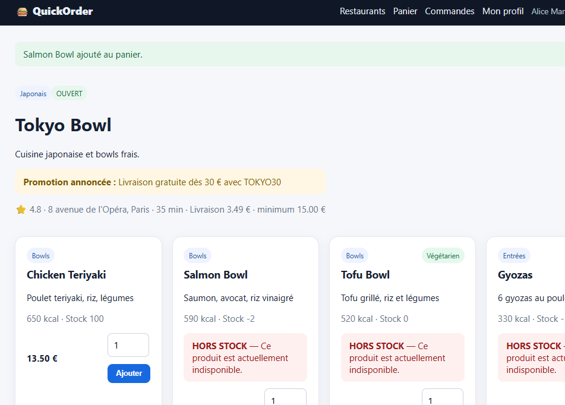
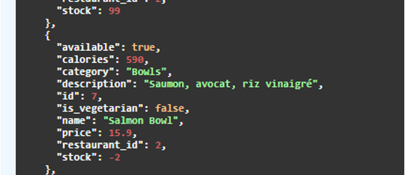
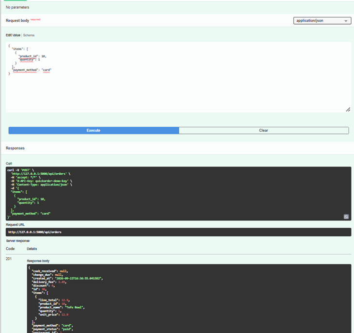
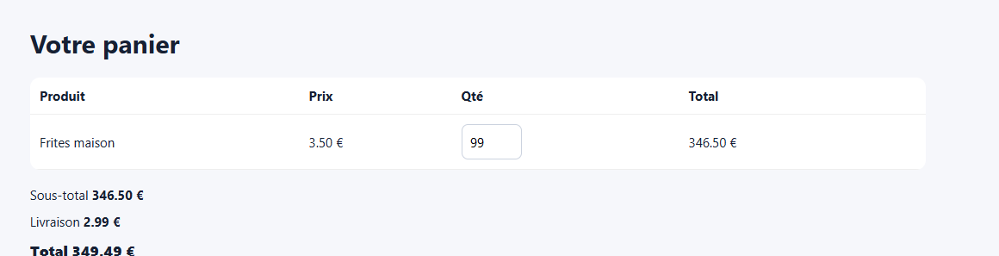

# BUG-07 : Le stock n'est jamais vérifié : un produit en rupture reste commandable et le stock devient négatif

## Contexte
Sur la fiche du restaurant Couscous Atlas, le produit "Tajine Légumes" (id=22) est affiché
avec la mention "HORS STOCK" (stock=0), mais le bouton "Ajouter" reste disponible. Le comportement a été
vérifié via l'API.

## Préconditions
Produit id=22, stock initial = 0, `available: true`, restaurant ouvert (pour isoler ce bug de BUG-06).

## Étapes de reproduction
1. Constater sur `GET /api/products/22` : `"stock": 0`.
2. Commander 2 unités : `POST /api/orders` avec `{"items":[{"product_id":22,"quantity":2}]}`.
3. Recontrôler le stock : `GET /api/products/22`.

## Résultat attendu
La commande devrait être refusée (stock insuffisant), et le stock ne devrait jamais passer sous 0.

## Résultat obtenu
- Commande créée avec succès (HTTP 201, commande #9, total 30,79 €).
- Stock du produit après commande : `"stock": -2`.

Le stock n'est décrémenté par aucune vérification de disponibilité réelle (seul le champ `available`,
indépendant du stock, est contrôlé).

## Preuve
Requête/réponse ci-dessus, exécutée le 21/09/2026. Stock confirmé négatif via
`GET /api/products/22` → `{"stock": -2, ...}`.

Même constat dans le navigateur et dans Swagger (22/09/2026) :
- produit « HORS STOCK » ajouté au panier, stock affiché ensuite à -2 :
  
- stock de Salmon Bowl à -2 dans `GET /api/restaurants/2/products` :
  
- commande créée (201) dans Swagger sur Tofu Bowl, affiché à stock 0 :
  
- quantité 99 acceptée dans le panier pour un produit à stock 98, puis commandée :
  

## Sévérité
Haute. Il s'agit d'une survente : une commande passée sur un produit épuisé fait passer le stock dans
le négatif, sans alerte.

## Priorité
Haute. Il faut vérifier `product.stock >= quantity` avant toute création de commande (web et API), et
idéalement rendre `available` dépendant de `stock > 0` plutôt que d'avoir deux champs indépendants qui
peuvent se contredire comme ici.
