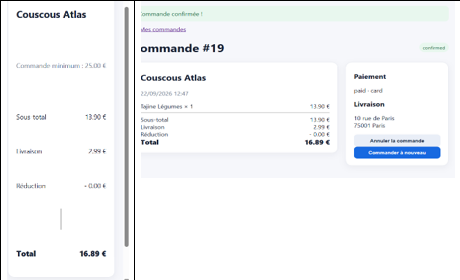
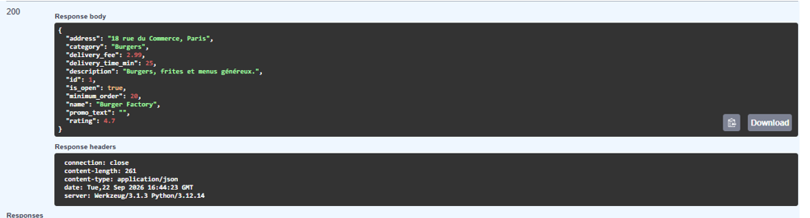

# BUG-08 : Le minimum de commande du restaurant n'est jamais appliqué

## Contexte
Le test dans le navigateur a montré que chaque restaurant affiche un « minimum de
commande » (Burger Factory : 20 €, Couscous Atlas : 25 €), sur sa fiche et dans le récapitulatif du
checkout. Ce minimum est affiché mais jamais vérifié au moment de valider la commande, ni dans
l'interface ni dans l'API.

## Préconditions
- Utilisateur connecté (interface) ou clé `X-API-Key: quickorder-demo-key` (API).
- Couscous Atlas : minimum 25 € ; Burger Factory : minimum 20 € (`GET /api/restaurants/1` →
  `"minimum_order": 20.0`).

## Étapes de reproduction
Interface :
1. Ajouter « Tajine Légumes » (13,90 €) de Couscous Atlas au panier.
2. Aller au checkout : le récapitulatif affiche « Commande minimum : 25.00 € » et un sous-total de 13,90 €.
3. Confirmer la commande.

API :
1. `POST /api/orders` avec `{"items":[{"product_id":3,"quantity":1}],"payment_method":"card"}`
   (Frites maison, 3,50 €, Burger Factory).

## Résultat attendu
La commande est refusée, avec un message qui indique le montant minimum à atteindre.

## Résultat obtenu
- Interface : « Commande confirmée ! », commande #19, sous-total 13,90 € pour un minimum de 25 €.
- API : HTTP 201, commande créée et payée à 3,50 € de sous-total pour un minimum de 20 € :
```json
{
  "restaurant_id": 1,
  "subtotal": 3.5,
  "total": 6.49,
  "status": "confirmed",
  "payment_status": "paid"
}
```

## Preuve
- Capture du checkout et de la confirmation (22/09/2026) :
  
- Minimum de Burger Factory dans Swagger :
  
- Requête API ci-dessus, rejouée le 12/10/2026 sur une base neuve (`seed.py`).

## Sévérité
Majeure. Le restaurant reçoit des commandes inférieures au minimum annoncé (par exemple, une portion de
frites à 3,50 € pour un minimum de 20 €), et la règle affichée au client n'est pas appliquée.

## Priorité
Haute. La vérification `subtotal >= restaurant.minimum_order` est simple à ajouter au checkout et dans
`POST /api/orders`.
