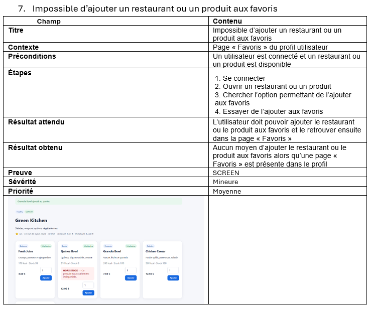

# BUG-12 : Impossible d'ajouter un restaurant aux favoris

## Contexte
Trouvé par Marina. Le profil contient une section « Favoris » et le README annonce la fonctionnalité
« favoris restaurants », mais aucune page ne propose de bouton pour ajouter un restaurant aux favoris.
La section reste donc toujours vide.

## Préconditions
Utilisateur connecté (`alice@example.com`).

## Étapes de reproduction
1. Ouvrir la fiche d'un restaurant (ex. Green Kitchen ou Tokyo Bowl).
2. Chercher un bouton ou une icône pour l'ajouter aux favoris.
3. Ouvrir « Mon profil » > section « Favoris ».

## Résultat attendu
Un bouton permet d'ajouter le restaurant aux favoris, et il apparaît ensuite dans « Favoris ».

## Résultat obtenu
- Aucun bouton « favori » sur la liste des restaurants ni sur les fiches.
- La section « Favoris » du profil affiche « Aucun favori. ».
- Contrôle dans le HTML de la fiche restaurant (connectée en Alice, 12/10/2026) : aucune occurrence de
  « favori » ni de lien vers `/favorite/...`, alors que cette route existe bien côté serveur.

## Preuve
Capture de la fiche Green Kitchen, sans bouton favori (22/09/2026) :

## Sévérité
Mineure. Le problème n'a pas d'impact sur la commande ou le paiement, mais une fonctionnalité annoncée
reste inutilisable.

## Priorité
Moyenne. Le serveur sait déjà enregistrer un favori : il manque seulement le bouton dans l'interface.
