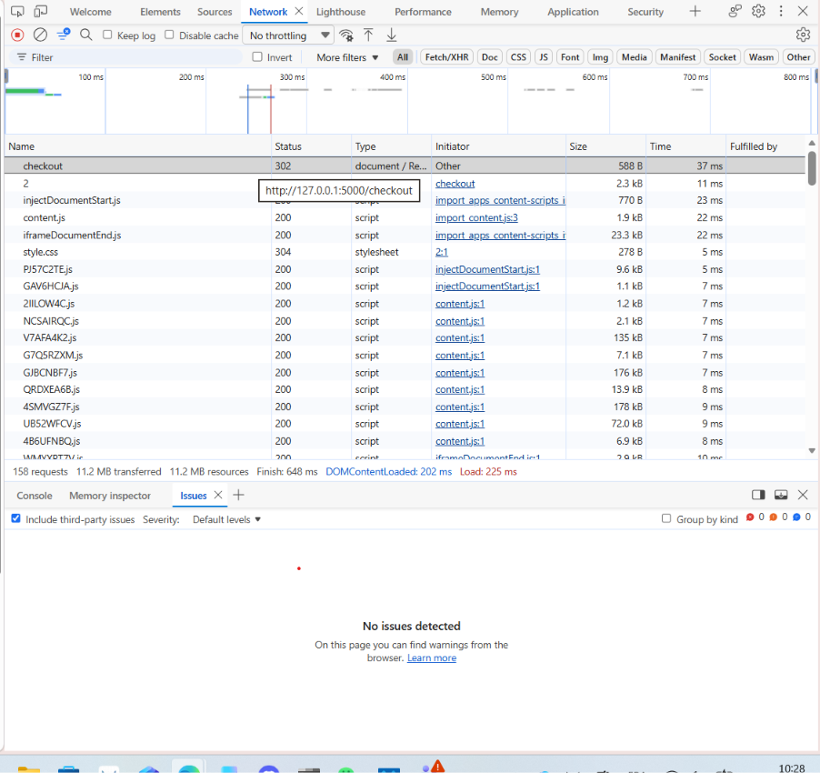

# Rapport d'exécution de la campagne : QuickOrder V3.1

## Comment on a testé

Campagne menée à deux (projet de groupe), avec deux approches complémentaires :

- **Elodie** (cas `TC-N`, `TC-L`, `TC-E`, `TC-B`, 21-22/09/2026) : instance locale lancée via
  `docker compose up --build`, base réinitialisée par `seed.py`. Exécution des cas contre l'API (curl et
  requêtes directes) et les pages web (HTML rendu), avec quelques vérifications en base SQLite quand
  l'info n'était pas visible depuis l'interface (ex : stock réel d'un produit).
- **Marina** (cas `TC-M`, 22/09/2026) : parcours joués dans le **navigateur** et dans **Swagger**
  (`/docs/`, bouton Authorize avec la clé `quickorder-demo-key`), avec captures d'écran à l'appui.
- **DevTools** (onglet Réseau, 12/10/2026) : observation des requêtes envoyées pendant une commande
  passée depuis l'interface. Le `POST /checkout` répond `302` et redirige vers la page de la commande
  créée : la commande est validée côté serveur en une seule requête de formulaire. C'est donc le serveur,
  et non l'interface, qui doit appliquer les règles (stock, minimum, restaurant ouvert, adresse).
  
- Toutes les captures sont dans `docs/preuves/` et sont reliées aux bug reports concernés. La colonne
  « Preuve » du tableur indique, pour chaque cas, où trouver la preuve.

## Résultats globaux

| Statut | Nombre | % |
|---|---|---|
| Pass | 28 | 64 % |
| Fail | 16 | 36 % |
| Blocked | 0 | 0 % |
| Skipped | 0 | 0 % |
| **Total** | **44** | 100 % |

## Par catégorie

| Catégorie | Cas | Pass | Fail |
|---|---|---|---|
| Nominaux | 10 | 9 | 1 |
| Limites | 10 | 8 | 2 |
| Erreurs | 11 | 6 | 5 |
| Règles métier | 13 | 5 | 8 |

Ce qui ressort de ce tableau : les parcours nominaux (connexion, inscription, recherche, commande
standard) fonctionnent, et les validations de formulaire sont bien faites (email, mot de passe, quantité
1 à 20). Les échecs se concentrent sur les **règles métier transactionnelles** (paiement, stock, minimum
de commande, restaurant fermé, statut, coupon) et sur le **contrôle d'accès de l'API**.

Les deux cas *Limites* en échec ne viennent pas des bornes 1-20, qui sont bien contrôlées, mais du
**stock** : une quantité supérieure au stock restant est acceptée (TC-M12, TC-M13). Notre matrice de
risques avait bien ciblé les coupons et le panier/commande, mais elle sous-estimait le stock (R9 notée
« basse ») et ne prévoyait ni le paiement (espèces, PayPal), ni le minimum de commande, ni l'adresse de
livraison, qui concentrent pourtant une bonne partie des bugs trouvés.

## Ce qui m'inquiète le plus

1. **Le contrôle d'accès sur l'API** (BUG-03), c'est celui qui m'a le plus surpris. N'importe qui avec
   la clé publique documentée dans le README peut agir sur le compte réel d'Alice sans jamais se
   connecter. Aucun mot de passe demandé, aucune session.
2. **La duplication PayPal** (BUG-05), une commande PayPal en crée deux en silence. Facile à louper si
   on ne compare pas le nombre de commandes avant/après.
3. **La survente** (BUG-06, BUG-07), restaurant fermé ou produit à stock 0, ça passe quand même, et le
   stock finit négatif.
4. **Le paiement espèces non vérifié** (BUG-04), un client pourrait payer 1€ pour une commande à 15€.
5. **Des promesses non tenues** (BUG-01, BUG-02), le coupon ATLAS15 annonce -15% mais applique -10%, et
   le filtre "frais de livraison max" fait l'inverse de ce qu'il promet.
6. **Des données pas fiables** (BUG-08, BUG-09), un statut de commande peut revenir en arrière, un avis
   peut être posté sans avoir jamais commandé.
7. **Une commande confirmée sans adresse valide** (BUG-10), trouvé en testant le parcours d'un nouveau
   compte : l'adresse créée automatiquement à l'inscription est vide, et rien n'empêche de payer avec.
8. **Le minimum de commande ignoré** (BUG-11), trouvé par Marina : il est affiché sur chaque restaurant
   mais jamais vérifié, une commande à 3,50 € passe chez un restaurant qui exige 20 €.
9. **Une fonctionnalité annoncée inutilisable** (BUG-12) : la section « Favoris » existe dans le profil
   mais aucun bouton ne permet d'y ajouter un restaurant.

## Notre avis : Go / No-Go

**No-Go** en l'état.

Aucun de ces bugs ne rend l'appli inutilisable, on peut toujours commander, payer, suivre sa commande.
Mais plusieurs touchent directement à l'argent (paiement espèces, doublon PayPal, survente, minimum de
commande ignoré, commande sans adresse livrable) ou à la sécurité (accès à un vrai compte client sans
authentification), et ça, on ne le laisserait pas passer en prod. On recommande une nouvelle campagne
ciblée sur BUG-01 à BUG-12 une fois les corrections faites, avant de redonner un avis.
