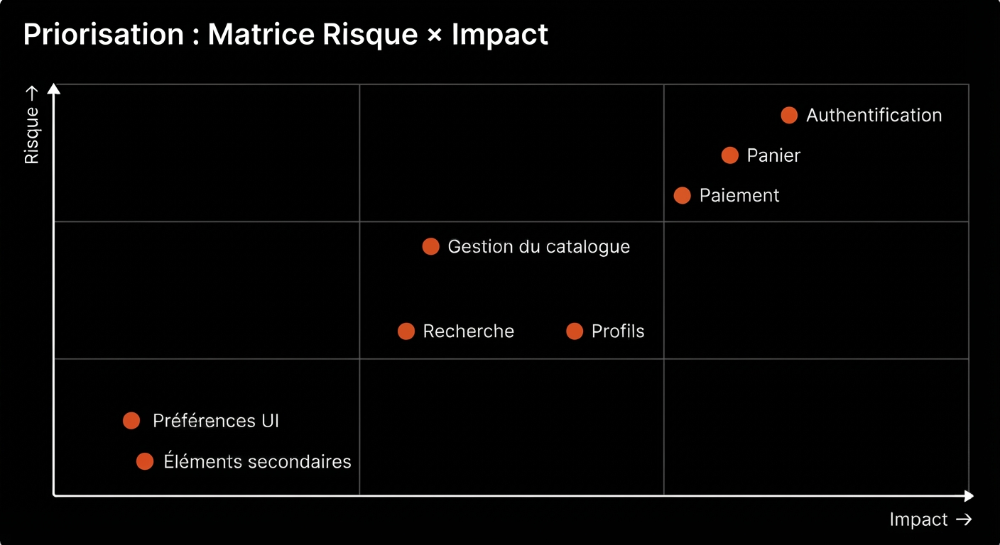

# Matrice des risques : QuickOrder V3.1

Avant la campagne, nous avons listé les zones susceptibles de poser problème, en nous basant sur les
risques courants des applications de commande et de livraison : paiement, coupons et contrôle d'accès.
Cette liste nous a servi à prioriser les cas de test.

Échelle : Probabilité (1=faible, 3=élevée) × Impact (1=mineur, 3=critique). Score = P × I.

| ID | Zone fonctionnelle | Risque | Probabilité | Impact | Score | Priorité test |
|---|---|---|---|---|---|---|
| R1 | Coupons | Mauvais calcul de réduction / plafond non respecté | 3 | 3 | 9 | Très haute |
| R2 | Commandes | Accès à une commande d'un autre utilisateur (IDOR) | 2 | 3 | 6 | Haute |
| R3 | Admin | Endpoint admin accessible à un compte client | 2 | 3 | 6 | Haute |
| R4 | Panier | Règle mono-restaurant contournable | 2 | 2 | 4 | Moyenne |
| R5 | Commandes | Annulation possible sur un statut qui ne devrait pas le permettre | 2 | 2 | 4 | Moyenne |
| R6 | Panier/Commande | Quantité hors bornes (0, négative, >20) acceptée | 2 | 2 | 4 | Moyenne |
| R7 | Auth | Mot de passe faible accepté / pas de contrôle de format email | 2 | 2 | 4 | Moyenne |
| R8 | Coupons | Coupon expiré accepté malgré tout | 1 | 3 | 3 | Moyenne |
| R9 | Produits | Produit indisponible commandable quand même | 1 | 2 | 2 | Basse |
| R10 | Avis | Note hors échelle (négative, >5) acceptée | 1 | 1 | 1 | Basse |
| R11 | UI | Incohérence d'affichage entre montant panier et total réel | 2 | 1 | 2 | Basse |
| R12 | API | Messages d'erreur incohérents entre endpoints (codes HTTP) | 2 | 1 | 2 | Basse |

## Ce que nous en retenons

Les scores les plus élevés concernent les **coupons**, le **contrôle d'accès** (IDOR/admin) et le
**panier/commande**. Ces zones concentrent plusieurs règles métier et peuvent avoir un impact direct sur
l'argent ou la confidentialité.

## Vue d'ensemble par zone

Une priorisation complémentaire a été réalisée à l'échelle des grandes zones de l'application. Plus un
point est haut et à droite, plus il mérite d'efforts de test et de preuves. L'authentification, le panier
et le paiement ressortent en tête, ce qui rejoint le tableau ci-dessus.

## Ce que la campagne a confirmé (et ce qu'on avait raté)

Comparaison faite après la campagne (voir `execution-report.md`) :

- **Bien vu** : coupons (R1 → BUG-01), panier/commande et contrôle d'accès de l'API (BUG-02).
- **Sous-estimé** : le stock (R9, classé en priorité « basse »), qui a donné l'un des bugs les plus graves (BUG-06).
- **Pas prévu** : le paiement (espèces BUG-03, doublon PayPal BUG-04), le restaurant fermé (BUG-05), le
  minimum de commande (BUG-08) et l'adresse de livraison (BUG-07).
- **Pas couverts par un cas de test** : R2 (voir la commande d'un autre client), R3 (client sur l'espace
  admin), R5 (annulation au mauvais statut) et R10 (note hors échelle).
- **Bornes de quantité (R6)** : contrôlées par l'API (1 à 20), les cas limites correspondants passent. Sur le
  site en revanche, aucune limite haute : une quantité de 99 a été acceptée dans le panier puis commandée (voir
  BUG-06).
